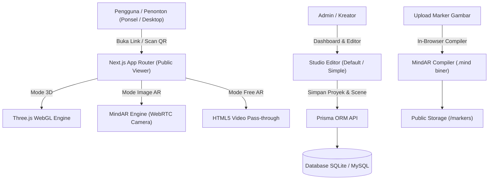

# Dokumentasi Lengkap: AR Studio BM3
**Platform Pembuat Konten 3D & Augmented Reality Berbasis Web**

---

## 1. Ringkasan Eksekutif & Visi Proyek

**AR Studio BM3** adalah platform web aplikasi internal kantor yang dirancang untuk membuat, mengelola, membagikan, dan menampilkan pengalaman **3D Interaktif** serta **Augmented Reality (WebAR)** tanpa memerlukan keahlian coding (*no-code / drag-and-drop*).

### 🎯 Tujuan Utama
- **Cepat & Mudah**: Pengelola dapat membuat dan mempublikasikan proyek AR dalam waktu kurang dari 5 menit.
- **Tanpa Instalasi Aplikasi (Web-Based)**: Penonton tidak perlu mengunduh aplikasi di App Store / Play Store. Konten dapat langsung dibuka dan dilihat di browser laptop maupun kamera ponsel melalui pemindaian **QR Code** atau tautan proyek.
- **Kombinasi Mode Pelacakan AR**:
  1. **Image Target Tracking (MindAR)**: Menempelkan objek 3D secara presisi di atas kartu marker fisik, kartu nama, brosur, atau kemasan.
  2. **Free Touch AR**: Mode kamera lingkungan fleksibel untuk menaruh objek di ruangan dengan gestur sentuh (geser, rotasi, cubit untuk perbesar/perkecil).
  3. **3D Orbit Studio**: Mode orbit 360 derajat interaktif di desktop dan perangkat tanpa kamera.

---

## 2. Arsitektur & Teknologi (Tech Stack)

Aplikasi dibangun menggunakan fondasi teknologi web modern, performa tinggi, dan mudah dirawat:

| Layer | Teknologi | Keterangan |
| :--- | :--- | :--- |
| **Framework Utama** | **Next.js 15 (App Router)** | Rendering SSR, Server Actions, API Routes, Turbopack, dan React 19. |
| **Bahasa Pemrograman** | **TypeScript** | Type-safety penuh pada komponen, backend API, dan model database. |
| **Styling & Tampilan** | **Modern Vanilla CSS** | Desain premium bertema gelap (*dark sleek theme*), *glassmorphism*, HSL tailoring, dan micro-animations. |
| **3D Engine** | **Three.js (r171 / r160)** | Rendering WebGL, pencahayaan, bayangan (*shadows*), *OrbitControls*, dan pemuat model 3D (*GLTFLoader*). |
| **AR Engine & Tracking** | **MindAR (v1.2.5)** | Pelacakan gambar WebAR murni di browser (*in-browser TensorFlow & WASM*) dan kompilator file `.mind`. |
| **Database & ORM** | **Prisma ORM + SQLite** | Relasi data terstruktur, mudah dioperasikan lokal dan siap dialihkan ke MySQL / PostgreSQL. |
| **Autentikasi & Keamanan**| **JWT + Bcrypt.js** | Enkripsi kata sandi akun admin pengelola studio dan proteksi rute dashboard. |
| **Utilitas Pendukung** | **Lucide Icons & QRCode** | Pustaka ikon modern dan pembuat QR Code dinamis langsung di canvas browser. |



---

## 3. Struktur Direktori Proyek

```
PROJEK AR V.1/
├── prisma/
│   ├── schema.prisma        # Skema model database Prisma (User, Project, Scene, Object, Asset, Marker)
│   ├── seed.js              # Script seeding akun admin default, starter assets, dan demo proyek
│   └── dev.db               # Database SQLite lokal
├── public/
│   ├── assets/              # Aset default (banner BM3, tekstur, model GLB)
│   ├── markers/             # File gambar target marker (.png, .jpg) dan file biner (.mind)
│   └── uploads/             # Direktori penyimpanan file upload pengguna
├── src/
│   ├── app/
│   │   ├── (auth)/
│   │   │   └── login/       # Halaman login otentikasi Admin
│   │   ├── (dashboard)/
│   │   │   ├── dashboard/   # Manajemen daftar proyek, buat proyek, filter status
│   │   │   ├── assets/      # Pustaka upload model 3D, gambar, audio, dan video
│   │   │   ├── markers/     # Studio marker: upload & kompilasi file .mind langsung di browser
│   │   │   └── layout.tsx   # Layout dashboard dengan bilah navigasi DashboardNav
│   │   ├── api/
│   │   │   ├── auth/        # Rute API login, logout, dan status sesi
│   │   │   ├── projects/    # CRUD proyek, duplikasi, dan update scene/objek
│   │   │   ├── assets/      # CRUD aset dan handler upload file
│   │   │   ├── markers/     # Simpan data marker dan upload hasil kompilasi .mind
│   │   │   └── network-info/# Deteksi otomatis alamat IP Wi-Fi lokal untuk pengujian HP
│   │   ├── editor/
│   │   │   ├── [id]/        # Full Studio Editor (Multi-scene, panel transform, animasi, trigger)
│   │   │   └── simple/[id]/ # Super Simple Editor (Wizard 3 langkah cepat)
│   │   ├── view/
│   │   │   └── [slug]/      # Universal Web Viewer (3D Orbit, MindAR Image Tracking, Free Touch)
│   │   ├── layout.tsx       # Root layout dengan importmap Three.js/MindAR dan suppressHydrationWarning
│   │   └── page.tsx         # Landing page resmi AR Studio BM3 + tombol pemindai AR
│   ├── components/
│   │   ├── 3d/
│   │   │   ├── Editor3DCanvas.tsx # Canvas WebGL interaktif untuk Default Studio Editor
│   │   │   └── Simple3DPreview.tsx# Preview 3D ringan untuk Super Simple Editor
│   │   ├── common/
│   │   │   ├── MobileScanModal.tsx    # Modal QR Code, pilih IP jaringan, dan petunjuk izin HP
│   │   │   └── ScanMarkerARButton.tsx # Tombol peluncur kamera AR instan di landing page
│   │   └── dashboard/
│   │       └── DashboardNav.tsx       # Navigasi utama dashboard studio
│   └── lib/
│       ├── auth.ts          # Helper token JWT dan proteksi endpoint API
│       ├── mindar-compiler.ts # Script kompilasi gambar target ke format .mind di sisi client
│       ├── prisma.ts        # Instance PrismaClient singleton
│       └── rate-limit.ts    # Proteksi pembatasan request API
├── package.json             # Konfigurasi dependensi dan skrip (dev, dev:https, build, db)
└── DOKUMENTASI.md           # Dokumen referensi proyek
```

---

## 4. Skema Database & Relasi (Prisma ORM)

Database dirancang fleksibel dengan struktur relasional modular:

### 1. `User`
Menyimpan kredensial pengelola studio (Admin / Editor).
- `id`: String (CUID)
- `email`: String (Unique)
- `passwordHash`: String (Bcrypt)
- `name`: String
- `role`: "ADMIN" | "EDITOR"

### 2. `Project`
Data proyek 3D/AR yang memiliki slug unik untuk dibagikan via URL.
- `id`: String (CUID)
- `title`: Judul proyek
- `slug`: URL unik publik (misal: `/view/demo-kantor-ar`)
- `mode`: `"DEFAULT"` (Studio Editor) atau `"SIMPLE"` (Wizard)
- `status`: `"PUBLISHED"` | `"DRAFT"` | `"PRIVATE"`
- `markerId`: Relasi ke target marker fisik yang digunakan
- `scenes`: Relasi 1-ke-banyak dengan `Scene`

### 3. `Scene`
Dukungan multi-slide presentasi AR.
- `id`: String (CUID)
- `order`: Urutan slide (0, 1, 2, dst.)
- `name`: Nama slide (misal: "Slide Pengenalan")
- `backgroundColor`: Warna latar saat mode 3D orbit
- `objects`: Relasi 1-ke-banyak dengan `Object`

### 4. `Object`
Komponen 3D di dalam scene.
- `type`: `"3D_MODEL"` | `"TEXT_3D"` | `"IMAGE"` | `"LIGHT"` | `"GEOMETRY"`
- `assetId`: Relasi opsional ke file di tabel `Asset`
- `transform`: JSON koordinat `{"position": [x,y,z], "rotation": [x,y,z], "scale": [x,y,z]}`
- `properties`: JSON konfigurasi objek (warna, animasi `SPIN/BOUNCE/PULSE`, aksi trigger `OPEN_URL/CHANGE_SCENE`, teks, kekasaran material).

### 5. `Asset`
Penyimpanan file yang diupload.
- `name`: Nama file
- `type`: `"MODEL_3D"` (`.glb`/`.gltf`), `"IMAGE"`, `"AUDIO"`, `"VIDEO"`
- `fileUrl`: Path publik akses file

### 6. `Marker`
Informasi penanda fisik gambar AR.
- `name`: Label marker
- `imageUrl`: Path gambar target visual
- `patternUrl`: Path file biner hasil kompilasi (`.mind`)
- `orientation`: `"HORIZONTAL"` (di atas meja/lantai) atau `"VERTICAL"` (di dinding/banner)
- `qualityScore`: Skor kualitas pola visual (0 - 100)

---

## 5. Fitur-Fitur Utama Aplikasi

### 5.1 Landing Page & Demo Langsung
- Beranda berdesain modern dengan ringkasan statistik proyek dan aset.
- Tombol **"Pindai AR (Kamera)"** yang terhubung langsung ke proyek demo.
- Tombol **"Buka Demo AR Interaktif"** dengan modal pemindai QR Code cerdas, mode layar penuh monitor (agar target bisa di-scan langsung dari layar laptop), dan panduan cetak dokumen.

### 5.2 Studio Dashboard (`/dashboard`)
- Pencarian dan filter proyek berdasarkan status (*Semua, Publik, Draft, Privat*).
- Opsi pembuatan proyek baru dengan pilihan **Default Studio** atau **Super Simple Wizard**.
- Fitur manajemen proyek: Ubah Nama, Ganti Status, Buka Editor, Duplikasi Proyek, dan Hapus.
- Shortcut buka pratinjau publik dan salin link instan.

### 5.3 Dual Studio Editor
Aplikasi menyediakan dua jenis editor sesuai kebutuhan pengguna:

#### A. Default Studio Editor (`/editor/[id]`)
- **Multi-Scene / Multi-Slide**: Menambah slide baru, mengubah urutan slide, dan mengatur background per slide.
- **Manipulasi 3D Lengkap**: Gizmo Transform (Geser Posisi, Rotasi Sumbu, Skala Ukuran).
- **Beragam Tipe Objek**:
  - Model 3D (`.glb` / `.gltf`) dengan bayangan dan pencahayaan dinamis.
  - Geometri primitif (Kubus kristal, Bola neon, Silinder, Torus).
  - Teks 3D floating label dengan latar transparan.
  - Gambar banner dan animasi GIF 2D di dalam ruang 3D.
  - Pencahayaan (Ambient Light & Directional Sun Light).
- **Animasi & Interaktivitas**:
  - Animasi looping: `SPIN` (berputar), `BOUNCE` (membal), `PULSE` (denyut).
  - Interaksi Trigger: Objek dapat diklik untuk membuka tautan URL atau berpindah ke slide berikutnya.
- **Fitur Autosave & Riwayat**: Undo/Redo serta penyimpanan otomatis ke database.

#### B. Super Simple Editor (`/editor/simple/[id]`)
- Alur kerja 3 langkah ramah pemula:
  1. **Langkah 1**: Pilih Gambar Marker Target AR.
  2. **Langkah 2**: Pilih Objek 3D atau Bentuk Geometri dan sesuaikan warna.
  3. **Langkah 3**: Atur Skala dan Simpan untuk langsung dibagikan.

### 5.4 Manajemen Marker & Kompilator In-Browser (`/markers`)
- Unggah gambar target AR format JPG atau PNG.
- Dilengkapi **MindAR In-Browser Compiler**: Gambar dikompilasi secara otomatis menjadi file biner `.mind` langsung di browser menggunakan WebAssembly/TensorFlow tanpa membebani server backend.
- Penilaian kualitas marker (*Quality Score* 0–100) untuk memastikan gambar memiliki detail kontras yang cukup agar mudah dilacak kamera.
- Pilihan orientasi: **Horizontal** (kartu nama/meja) atau **Vertical** (poster/spanduk/dinding).

### 5.5 Universal Public Viewer (`/view/[slug]`)
- Dibuka penonton melalui tautan `/view/[nama-proyek]`.
- **Mode 3D Orbit**: Memutar model 360°, zoom, dan pan dengan kontrol mouse atau sentuhan jari.
- **Mode Image Tracking AR (MindAR)**:
  - Kamera aktif dan mencari pola gambar target marker.
  - Ketika kartu/gambar terdeteksi, konten 3D langsung muncul dan terkunci di atas gambar fisik secara stabil (*real-time 6DoF tracking*).
  - Tampilan reticle pemindai futuristik dengan laser scanline.
- **Mode Free Touch AR**: Kamera lingkungan aktif tanpa target fisik; pengguna dapat menggeser dan mengatur posisi objek 3D di layar secara bebas.
- **Fitur Tangkapan Layar (Foto AR)**: Tombol rana kamera untuk mengambil foto hasil penggabungan dunia nyata dan model 3D secara instan.
- **Navigasi Multi-Slide**: Berpindah antar slide dengan tombol navigasi melayang tanpa keluar dari mode AR.

---

## 6. Panduan Instalasi & Menjalankan Aplikasi

### Persyaratan Sistem
- **Node.js**: Versi 18.17.0 ke atas (direkomendasikan Node.js 20 LTS).
- **NPM**: Versi 9 ke atas.
- **Browser**: Google Chrome, Mozilla Firefox, Microsoft Edge, atau Safari terbaru dengan dukungan WebGL dan WebRTC (Kamera).

### Langkah-Langkah Instalasi

1. **Buka Terminal di Direktori Proyek**:
   ```bash
   cd "d:\1 APPS\1 KERJAAN BM3 APPS\PROJEK AR V.1"
   ```

2. **Instal Seluruh Dependensi**:
   ```bash
   npm install
   ```

3. **Sinkronisasi Database & Generate Prisma Client**:
   ```bash
   npm run db:push
   ```

4. **Jalankan Seeding Data Awal (Admin, Marker, & Proyek Demo)**:
   ```bash
   npm run db:seed
   ```
   *Akun Admin Default:*
   - **Email**: `admin@bm3.id`
   - **Password**: `admin123`

---

## 7. Menjalankan Server Aplikasi

Aplikasi memiliki dua mode eksekusi di lingkungan pengembangan:

### Mode 1: Server Standar (HTTP)
Gunakan perintah ini untuk pengujian di komputer/laptop:
```bash
npm run dev
```
Akses di browser laptop: `http://localhost:3000`

---

### Mode 2: Server HTTPS Otomatis (Sangat Disarankan untuk Uji Coba di Ponsel)
Next.js 15 dilengkapi fitur HTTPS otomatis yang menghasilkan sertifikat SSL lokal sehingga browser HP langsung membuka izin kamera:
```bash
npm run dev:https
```
Akses di browser laptop/HP: `https://[IP-LOKAL-PC]:3000` *(misal: `https://192.168.1.4:3000`)*.
> 💡 *Pada tampilan pertama di HP, pilih tombol **"Advanced" / "Lanjutan"** lalu tap **"Proceed to site / Lanjutkan (tidak aman)"**.*

---

## 8. Panduan Khusus Uji Coba AR di Ponsel (Satu Jaringan Wi-Fi)

### Mengapa Muncul Pembatasan Kamera di HP?
Browser ponsel (khususnya Google Chrome di Android dan Safari di iOS) menerapkan aturan keamanan global (*Secure Context*): **kamera hanya boleh diakses pada URL `https://` atau `http://localhost`**. Jika dibuka melalui IP Wi-Fi biasa (`http://192.168.x.x`), browser ponsel secara otomatis memblokir kamera.

Terdapat 2 solusi mudah:

### Solusi A: Aktifkan Chrome Flags di HP Android (Langkah 1 Menit)
Jika Anda menjalankan server dengan `npm run dev` (HTTP biasa):
1. Sambungkan HP ke jaringan **Wi-Fi yang sama** dengan laptop.
2. Buka aplikasi **Google Chrome** di ponsel.
3. Di bilah alamat (*address bar*), ketik:
   ```text
   chrome://flags
   ```
4. Di kolom pencarian *"Search flags"*, ketik:
   ```text
   unsafely-treat
   ```
   *(Akan muncul pengaturan: **Insecure origins treated as secure**)*.
5. Ubah opsi dari **Disabled** menjadi **Enabled**.
6. Masukkan alamat IP Wi-Fi laptop Anda ke dalam kotak teks yang tersedia:
   ```text
   http://192.168.1.4:3000
   ```
   *(Anda juga bisa menggunakan tombol **"Salin"** yang ada pada modal aplikasi).*
7. Tekan tombol biru **Relaunch** di pojok kanan bawah Chrome.
8. Scan kembali QR code proyek atau buka link `http://192.168.1.4:3000/view/demo-kantor-ar?ar=1`. Kamera akan langsung aktif normal.

### Solusi B: Gunakan Mode `npm run dev:https`
Jalankan server dengan HTTPS otomatis, lalu buka tautan berawalan `https://192.168.1.4:3000`. Kamera otomatis aktif tanpa perlu mengubah Chrome flags.

---

## 9. Dokumentasi Endpoint API Backend

| Kategori | Method | Endpoint | Fungsi |
| :--- | :--- | :--- | :--- |
| **Auth** | `POST` | `/api/auth/login` | Login admin, memverifikasi password bcrypt, mengembalikan cookie JWT sesi. |
| | `POST` | `/api/auth/logout` | Menghapus cookie sesi autentikasi. |
| | `GET` | `/api/auth/me` | Memeriksa status dan profil admin yang sedang login. |
| **Projects** | `GET` | `/api/projects` | Mengambil seluruh daftar proyek (dengan opsi filter). |
| | `POST` | `/api/projects` | Membuat proyek baru. |
| | `GET` | `/api/projects/[id]` | Mengambil data proyek lengkap berserta seluruh scene dan objeknya. |
| | `PUT` | `/api/projects/[id]` | Menyimpan perubahan konfigurasi proyek, urutan scene, dan data transform objek 3D. |
| | `DELETE`| `/api/projects/[id]` | Menghapus proyek beserta scene dan objek di dalamnya. |
| | `POST` | `/api/projects/[id]/duplicate` | Menduplikasi proyek beserta seluruh isi scene dan objeknya. |
| **Assets** | `GET` | `/api/assets` | Mengambil daftar file pustaka aset digital. |
| | `POST` | `/api/assets/upload` | Mengunggah model 3D (`.glb`), gambar, video, atau audio ke server. |
| | `DELETE`| `/api/assets/[id]` | Menghapus file aset dari server dan database. |
| **Markers** | `GET` | `/api/markers` | Mengambil daftar target marker AR yang terdaftar. |
| | `POST` | `/api/markers` | Menyimpan marker baru beserta file gambar dan file biner `.mind`. |
| | `DELETE`| `/api/markers/[id]` | Menghapus data marker dari sistem. |
| **Network** | `GET` | `/api/network-info` | Mengembalikan daftar alamat IP lokal mesin host (IPv4 Wi-Fi/LAN) untuk QR code mobile. |

---

## 10. Tips Penggunaan & Troubleshooting

### 1. Objek 3D Belum Muncul Saat Mengarahkan Kamera ke Marker
- Pastikan pencahayaan ruangan cukup terang dan tidak ada pantulan cahaya (*glare*) yang menyilaukan pada permukaan kartu.
- Pastikan orientasi marker sesuai (apakah diatur **Horizontal** diletakkan di atas meja, atau **Vertical** dipasang di dinding).
- Jika menguji coba tanpa mencetak kartu fisik, Anda dapat mengklik tombol **"Buka Layar Penuh (Scan dari Layar Monitor)"** pada modal target, lalu arahkan kamera ponsel ke monitor laptop Anda.

### 2. Peringatan Hydration Mismatch di Browser
- Peringatan hidrasi yang dipicu oleh ekstensi browser (seperti Google Chrome Remote Desktop `__gcrremoteframetoken` atau translator) telah dinonaktifkan secara aman menggunakan `suppressHydrationWarning` pada tag `<html>` dan `<body>` di [`src/app/layout.tsx`](file:///d:/1%20APPS/1%20KERJAAN%20BM3%20APPS/PROJEK%20AR%20V.1/src/app/layout.tsx).

### 3. Error Memori Saat Instalasi MindAR
- Engine MindAR pada aplikasi ini dimuat secara dinamis di sisi peramban (*in-browser ESM dynamic import via CDN / importmap*), bukan melalui build native Node.js canvas C++. Hindari menjalankan `npm install mind-ar` secara global/lokal agar kapasitas disk mesin Windows tetap terjaga hemat.

---

## 11. Pengembang & Lisensi

- **Aplikasi**: AR Studio BM3 (v1.0.0)
- **Lingkup**: Aplikasi Web Internal Kantor BM3
- **Tahun**: 2026
- **Status Rilis**: Produksi Internal & Pengembangan Berkelanjutan
